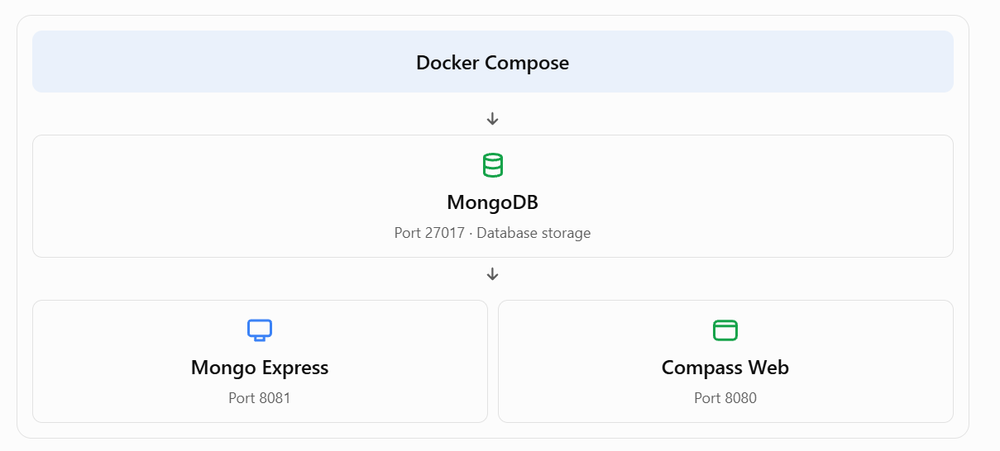

# mongoDB-k8s

# Architecture
The architecture will have three services:
1. MongoDB – stores the database and sample data.
2. Mongo Express – browser-based database administration.
3. MongoDB Compass – graphical interface for exploring databases, collections, documents, and queries.

One distinction: Compass is a desktop application, so running it in a container requires a graphical desktop or remote-browser interface. 
It will connect to the same MongoDB database as Mongo Express.   

     